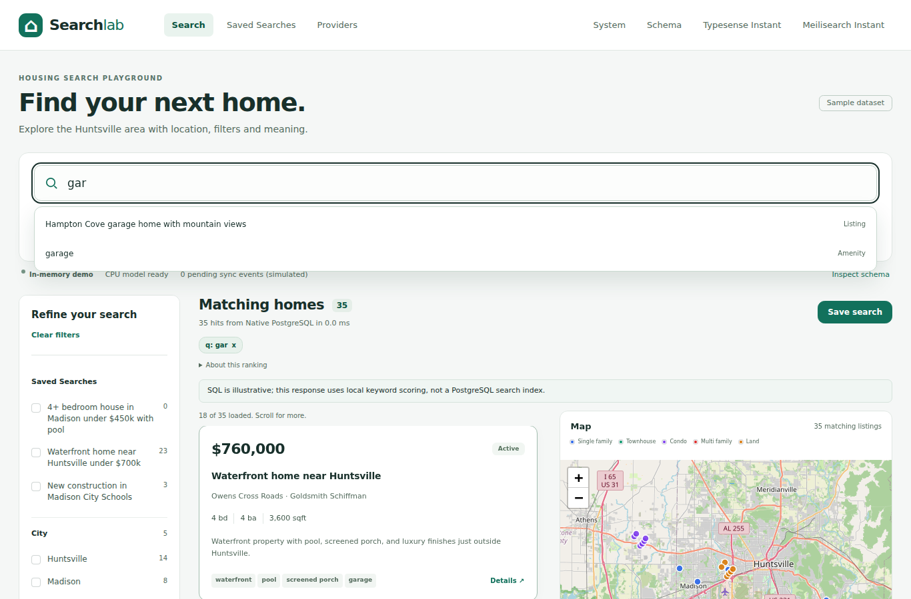
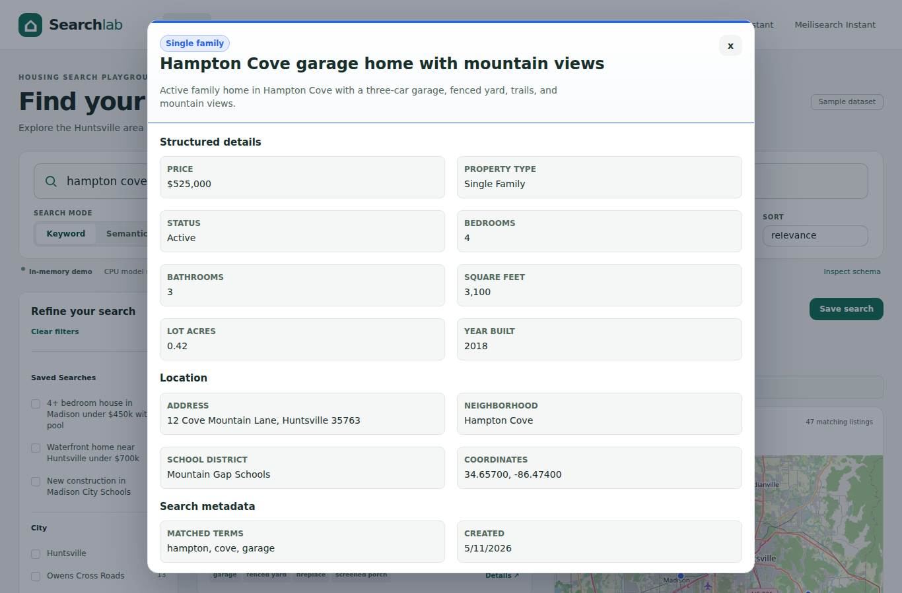
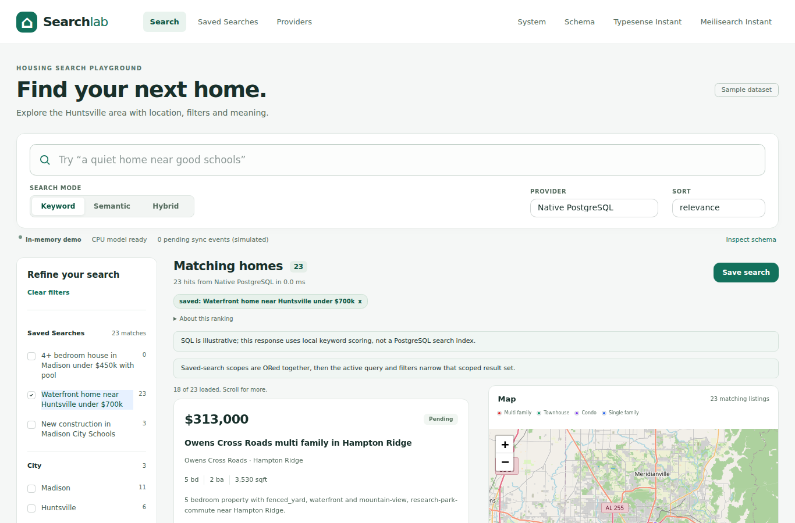
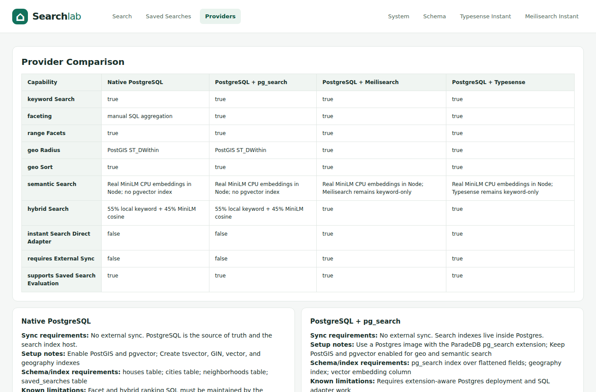

# Search Options Demo

Runnable TypeScript demo for comparing faceted, geo-aware, semantic, and saved-search behavior across search provider strategies for location-based housing data.

The app is intentionally small enough to inspect end to end: a Node API/static server, a Vite-bundled frontend, shared search contracts, deterministic fixtures, sync/backfill scripts, and Playwright coverage.

## Search Options

| Option | Backend shape | Implemented behavior |
| --- | --- | --- |
| Native PostgreSQL | Source-of-truth PostgreSQL with SQL geo filtering, native FTS and pgvector | Keyword, semantic, and hybrid scoring; manual facets; range filters; geo radius; distance sorting; saved-search evaluation |
| PostgreSQL with `pg_search` | Postgres-hosted search extension strategy | Actual ParadeDB BM25 index scans with pgvector semantic/hybrid SQL and backend-owned filters/facets |
| PostgreSQL plus Meilisearch | External search index synchronized from Postgres | Facets, range filters, geo filtering/sorting, native semantic/hybrid search, direct InstantSearch demo, backfill, and sync-worker controls |
| PostgreSQL plus Typesense | External search collection synchronized from Postgres | Faceted collection schema, geopoint and native vector queries, direct InstantSearch demo, backfill, and sync-worker controls |

The in-memory demo uses a pinned MiniLM CPU model. In the connected stack, PostgreSQL automatically generates durable embeddings through PGMQ and scores them with real pgvector SQL; Meilisearch and Typesense generate document/query embeddings natively from the same base MiniLM model. No vectors are pushed into either appliance. See [automatic embeddings](docs/automatic-embeddings.md) for setup, model/runtime differences, queue safety and measured costs.

## Features

### Search Experience

- **Debounced updates** - Search text updates results, facets, and debug output without replacing the focused search box.
- **Search suggestions** - Suggestions come from listing titles, saved-search names, cities, neighborhoods, amenities, and property types.
- **Search modes** - Keyword, semantic, and hybrid modes share the same frontend contract. Semantic search uses 384-dimensional MiniLM embeddings: q8 in Node/Typesense and float32 in Meilisearch. Each backend owns its hybrid ranking policy.
- **Sort modes** - Results can be sorted by relevance, distance, price, or newest update.
- **Virtualized infinite results** - The main result pane uses TanStack Virtual to render only visible cards while appending more API pages as the user scrolls.

### Filtering And Facets

- **Facet rail** - City, neighborhood, school district, property type, bedrooms, amenities, and listing status are exposed as left-rail filters.
- **Bounded facet lists** - Long facet groups are capped by default with a show-more control, while selected values remain visible.
- **Range filters** - Price, square feet, lot size, and year-built filters update the same search contract as categorical facets.
- **Removable chips** - Active query, saved-search, facet, range, geo, and viewport refinements appear above results and can be removed in place.
- **Clickable result chips** - Listing chips such as `garage` can apply matching filters directly from a result card.

### Saved Searches

- **Live counts** - Saved searches display current match counts in the filter rail.
- **OR scoping** - Selecting multiple saved searches ORs their result sets together before manual filters narrow the visible content.
- **Save in place** - Saving the current query and manual filters adds the new saved search to the filter rail, selects it, and keeps the user on `/search`.
- **Zero-hit support** - Searches with no current results can still be saved and reevaluated later.

### Geo And Provider Operations

- **Geo presets** - Radius filters model location-aware search around Huntsville, Madison, and Redstone Arsenal.
- **Viewport filter** - A sample map viewport constraint demonstrates bounding-box filtering.
- **Result map** - Leaflet and OpenStreetMap tiles show all matching listing locations with color-coded property-type markers.
- **Hit details** - Clicking a result opens a structured overlay with listing fields, location data, search metadata, amenities, tags, and JSON.
- **Sync controls** - Backfill and worker buttons demonstrate external-index synchronization for Meilisearch and Typesense.

## Screenshots

**Historical PR #3 captures below:** these images predate the compact UI and real-service successor. They are not evidence of the current real stack. Current acceptance images must be captured from native services, visually reviewed, and labeled with their source commit and provider before replacing these references.

### Search Results


### Search Suggestions



### Hit Details



### Saved Search Scope



### Provider Comparison



## Run the Real Comparison (Docker Compose)

```bash
npm ci
npm run dev
# In a second terminal, wait for the API before seeding:
for attempt in $(seq 1 60); do
  curl -fsS http://127.0.0.1:5173/api/providers >/dev/null && break
  sleep 2
done
curl -fsS http://127.0.0.1:5173/api/providers >/dev/null && npm run seed
```

Open <http://127.0.0.1:5173/search>. The default demo runs real PostgreSQL FTS, ParadeDB BM25, pgvector, Meilisearch and Typesense. Pinned public models are downloaded once; no paid embedding API is used. Seeded records queue automatic embeddings/indexing, and System shows when they are ready.

`npm run dev` builds the frontend/models and starts the real Compose stack. For an API connected to an existing PostgreSQL/engine setup, configure `DATABASE_URL` and service variables, then use:

```bash
npm run api:dev
```

For Vite's standalone dev server with API proxying, use:

```bash
npm run web:dev
```

## Run With Real Services

```bash
npm run stack:full:detached
# Detached startup returns before the app finishes installing dependencies.
for attempt in $(seq 1 60); do
  curl -fsS http://127.0.0.1:5173/api/providers >/dev/null && break
  sleep 2
done
curl -fsS http://127.0.0.1:5173/api/providers >/dev/null && npm run seed
# Embeddings and appliance indexes populate automatically in the background.
curl http://127.0.0.1:5173/api/embedding-jobs
```

The full stack runs Postgres, Meilisearch, Typesense, and the same web/API app at <http://127.0.0.1:5173/search>. With `DATABASE_URL` present, saved searches, source invalidations and PGMQ jobs are stored in Postgres. A bounded CPU worker creates pgvector embeddings; Meilisearch and Typesense generate their own embeddings from queued source documents. Semantic search reports pending status until its selected index is ready.

Direct adapter routes are available at:

- <http://127.0.0.1:5173/search/instant/typesense>
- <http://127.0.0.1:5173/search/instant/meilisearch>

Those pages use Vite-bundled `instantsearch.js` with `typesense-instantsearch-adapter` and `@meilisearch/instant-meilisearch`. They point at exposed local search ports and use development keys for inspectable local behavior.

## Verify

```bash
npm run typecheck
npm run verify:embeddings
SCREENSHOT_BASE_URL=http://127.0.0.1:5173 npm run screenshots:update
npm test
# Destructive smoke check: only against your disposable demo stack.
TEST_DISPOSABLE_STACK=1 DEMO_URL=http://127.0.0.1:5173 npm run verify:full-stack
```

`npm run verify:embeddings` exercises actual CPU inference and API retrieval, offline loading, cache invalidation, semantic saved searches, and error recovery in disposable local processes. It does not require the external Docker stack.

`verify:full-stack` resets listings and saved searches and edits a fixture listing. Both the explicit target and disposable-stack opt-in are required before it makes requests. Do not point it at a valuable or shared dataset. Seeding is also a reset. For owned-process, all-provider native acceptance, use the guarded commands in [automatic embeddings](docs/automatic-embeddings.md#verification-and-measured-costs).

The Playwright suite covers live debounced search, search suggestions, virtualized infinite results, facet limiting, removable refinement chips, clickable result chips, saved-search scoping, provider switching, direct InstantSearch routes, and external sync controls.

Screenshots require an already-running, seeded real stack and `SCREENSHOT_BASE_URL`. Wait until System reports current documents and no pending/failed work before capture. The real-comparison GitHub Actions workflow runs on pull requests and uploads only fresh captures plus execution/layout evidence. The separate internal UI workflow runs fixture regressions and does not publish acceptance screenshots. The committed `githooks/pre-push` hook is fast by default; set `RUN_SCREENSHOT_PRE_PUSH=1` when you want local pushes to regenerate screenshots and block on uncommitted image diffs.

## Demo Commands

```bash
npm run seed
npm run search:backfill -- --provider meilisearch
npm run search:backfill -- --provider typesense
npm run search:sync-worker
npm run search:reset -- --provider meilisearch
npm run search:reset -- --provider typesense
```

These scripts call the same local API used by the web UI when it is running.

## Repository Layout

```text
apps/api                  Local API and static server
apps/web-angular/src      Frontend app and styles
packages/domain           Domain types
packages/search-contracts Shared search and saved-search contracts
packages/search-transform Search document transforms
packages/test-fixtures    Deterministic housing, city, and saved-search data
scripts                   Seed, backfill, reset, sync, and verification scripts
tests                     Playwright browser coverage
docs                      Specification, implementation notes, and screenshots
compose                   Docker Compose stacks for provider experiments
```

### Durable and native embedding verification

The full stack builds PostgreSQL 15.19 with ParadeDB pg_search 0.26.1, PGMQ 1.13.0 and pgvector 0.8.7, uses Meilisearch 1.11.3 and Typesense 28.0, and starts its bounded worker automatically. `npm run native-models:prepare` verifies pinned public model files. See [the automatic generation and native-engine guide](docs/automatic-embeddings.md) for actual integration tests and the PostgreSQL-only option.

`npm run demo:memory` is an explicit internal fixture/mechanics mode, not the comparison demo. Real screenshots and browser acceptance use an owned disposable database and native service instances; connected errors never fall back to fixtures.
