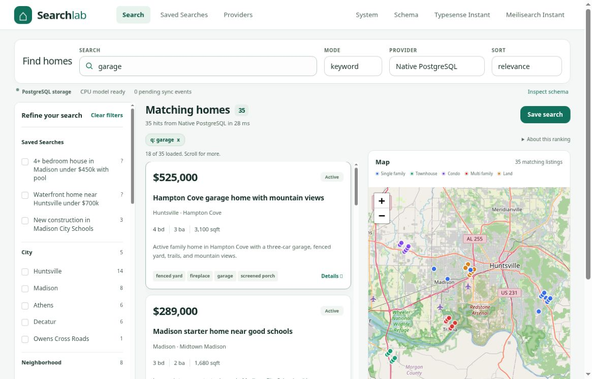

# Actual PostgreSQL screenshot

Captured 2026-10-13 at **1180 × 757** from the real local PostgreSQL demo:
- Provider: Native PostgreSQL; mode: keyword; query: `garage`
- Actual execution: `postgres-fts`; **35 matches**
- All 9 visible OpenStreetMap tiles loaded and opaque
- Serving source: `7917503e774e34ada51a560ee334ddefd5c84b54`, whose app runtime is identical to PR4 `0184b6efd00d7eb8522c411b698640ec7f75ff09`; its only difference is screenshot automation
- Independently inspected; original PNG bytes preserved (Git blob `f5c3fb858c79a84be03e6ccf4c61f8641292f5c5`)

This proves the shown PostgreSQL view only. The full multi-provider screenshot gallery, mobile capture and final CI are separate pending checks. Other screenshot files inherited from PR3 remain historical unless explicitly identified as current real-service evidence.
