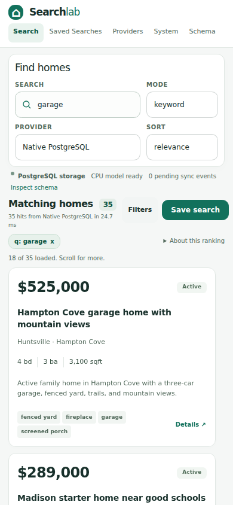

# Actual PostgreSQL screenshot

Captured 2026-10-13 at **1180 × 757** from the real local PostgreSQL demo:
- Provider: Native PostgreSQL; mode: keyword; query: `garage`
- Actual execution: `postgres-fts`; **35 matches**
- All 9 visible OpenStreetMap tiles loaded and opaque
- Serving source: independently reviewed `9dcedfd5d19812a5779cec73f1555fd38caf6f85`; its frontend changes are included in this PR commit. Both secondary-information controls are collapsed; the first result starts at y=219px and two complete cards are visible
- Independently inspected; original PNG bytes preserved (Git blob `73a55e6181a21293c2d551facab43410210a3829`)

This proves the shown PostgreSQL view only. The full multi-provider screenshot gallery, mobile capture and final CI are separate pending checks. Other screenshot files inherited from PR3 remain historical unless explicitly identified as current real-service evidence.

[Earlier real PostgreSQL view](screenshots/actual-pg-desktop.png) shows the preceding layout before secondary information was compacted. It remains historical evidence, not the latest layout.

## Actual PostgreSQL mobile, before the final collapse change

This **390 × 844** capture is from [successful real-service CI at source `0184b6e`](https://github.com/rothnic/faceted-search/actions/runs/38464194492). It shows PostgreSQL keyword `garage`, 35 matches, loaded map tiles, no warnings/overflow, and one complete card (first-card y=447px). It has been independently inspected. It **precedes** the secondary-information collapse shown in the latest desktop image above; it is not a matching final-layout mobile claim. Original PNG bytes are preserved: Git blob `229cfc9e40305f1b1415bd145b50fa6ab00fdb04`.
