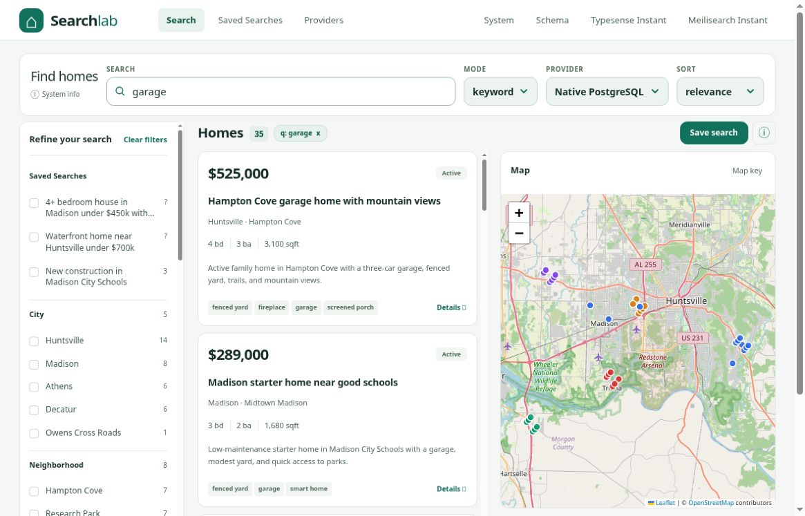
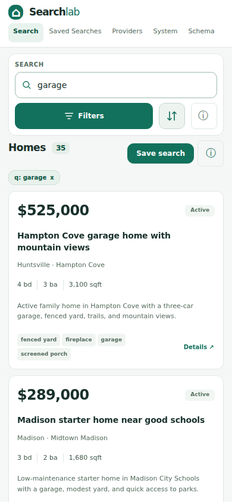

# Actual PostgreSQL screenshots

## Desktop: aligned labels and distinct select controls

Captured 2026-10-13 at **1180 × 757** from actual PostgreSQL: provider Native PostgreSQL, keyword query `garage`, execution `postgres-fts`, **35 matches**. All 9 visible map tiles loaded and were opaque. Secondary-information controls are collapsed; all four labels align at y=93px, and selects have tinted fills and visible chevrons.

Serving source was independently reviewed `1ced507bba5f332ed9f454d9b554eab3e22219ce`, whose app runtime is included unchanged in published checkpoint `6dec3f5ec5fdbd142be05bbd585e084b3390ac31`. The original independently inspected PNG has Git blob `5ccd8d42807f2cfba70f1c0f9520bc62581f9270`.

## Mobile: matching refined-control runtime

This **390 × 844** image comes from [successful real-service CI at source `6dec3f5`](https://github.com/rothnic/faceted-search/actions/runs/38467946833). It shows the same actual PostgreSQL `garage` query and 35 matches, full-width search, compact filters/sort controls and centered cards. First-card y=320.5px; one complete card and two intersecting cards; no execution warnings or horizontal overflow. The screenshot automation also verified the actual map tiles before capture, though the map is below this viewport. Original independently inspected PNG blob: `65c3f6982ef45489fa649b7c1c6cca57ad8da9ab`.

Both workflows passed on this runtime: 41 internal UI regressions, actual PostgreSQL/ParadeDB/Meilisearch/Typesense integration, 12 genuine-service browser cases and 14 real-service screenshots. A later mobile Map/List refinement, if introduced, is separate and is not claimed by these images.

## Earlier captures

- [Original real PostgreSQL desktop](screenshots/actual-pg-desktop.png), before secondary information was compacted
- [Collapsed-info desktop](screenshots/actual-pg-collapsed-desktop.png), before aligned labels and select styling
- [Earlier real mobile](screenshots/actual-pg-mobile-precollapse.png), source `0184b6e` before the collapse/control refinements

Other screenshot files inherited from PR3 remain historical unless explicitly identified as current real-service evidence.
