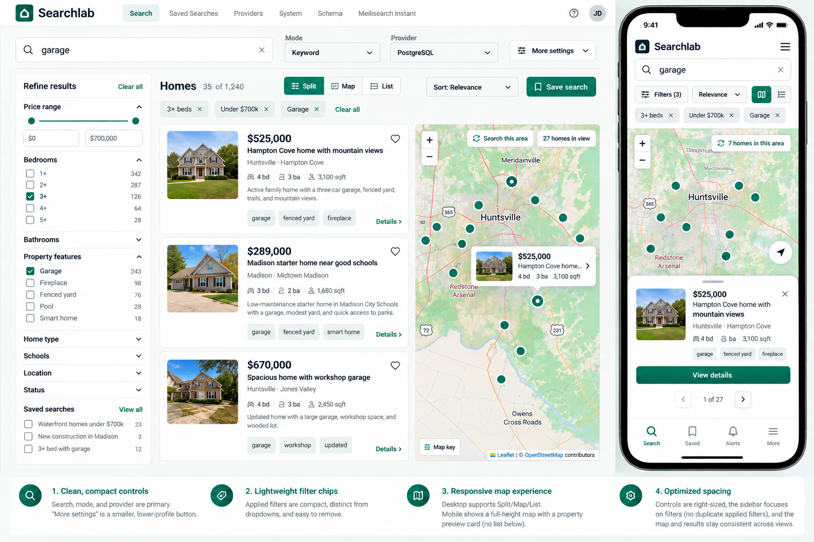

# Searchlab responsive search UX context

The image is the original Library reference (1536 × 1024, SHA-256 `ff3e94b39f05c25619e990d2a1fb753fb2a19f2810aaa00519823e9af2c52271`). It illustrates the desktop facets/list/map arrangement, compact controls and mobile map preview.

The normative specification is [Searchlab responsive search requirements v2](searchlab-responsive-search-v2.md), copied from the user-supplied Library file with SHA-256 `7225a9a1489da5826ab7120870a903e90b801d6ca6e2f2eba3b230d266c26ff3`. The image is a layout reference; its listing values are illustrative. Where the image omits mobile Homes, total counts or Save, v2 explicitly requires them and takes precedence.

The UI keeps the existing search state and saved-search behavior, including OR across checked saved-search scopes. It adds explicit desktop Split/Map/List presentations, preserves marked stale results during refetch, renders a shell before bootstrap completes, and loads Leaflet only when a map is visible.

Responsive UI and loading checks live in `tests/compact-search-ux.spec.ts`, `tests/map-view-ux.spec.ts`, `tests/search-demo.spec.ts`, and `tests/system-ux.spec.ts`. The suite measures responsive bounds, delayed-response geometry, query counts, and actual search payload bytes. It does not assert unstable production performance metrics from one local run.
