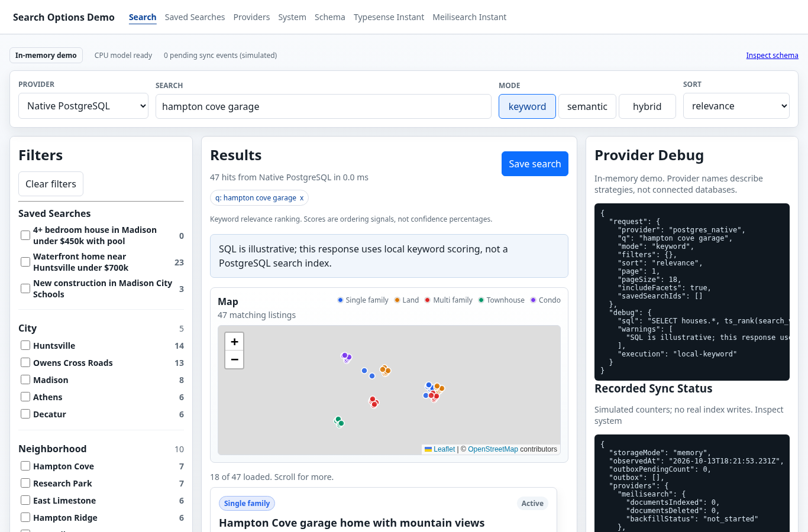
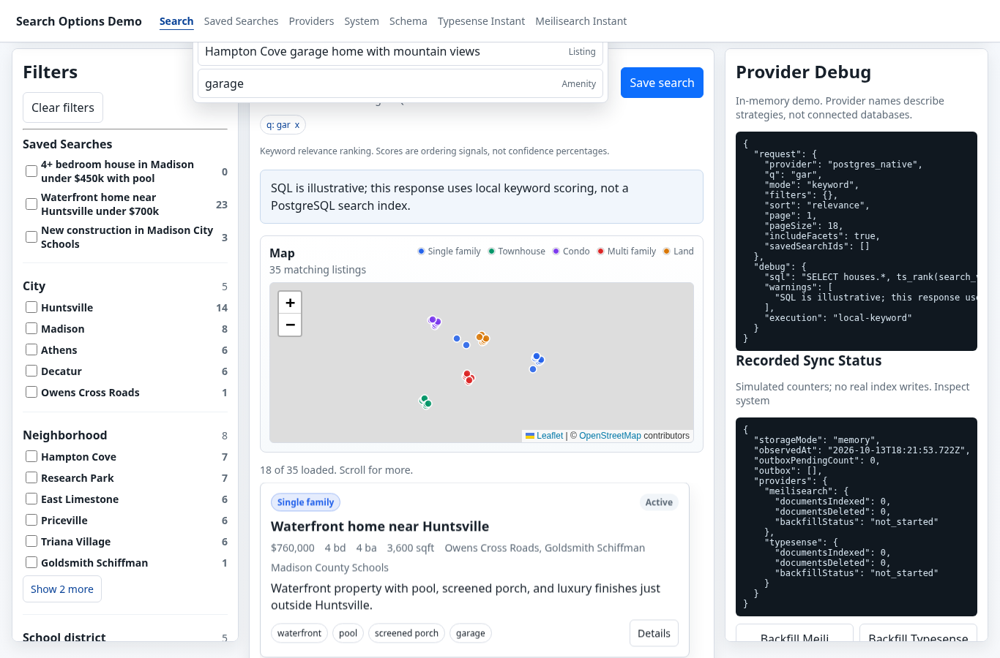
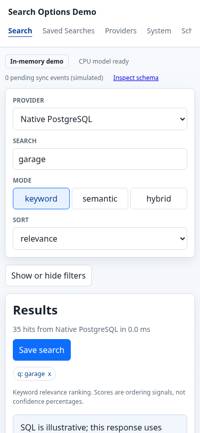
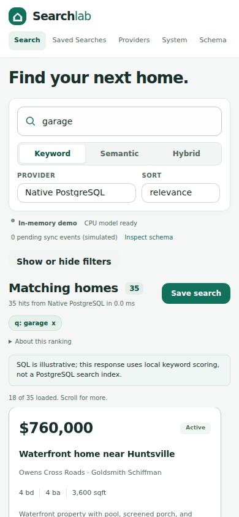

# Search UI visual refresh

The prior screenshot set passed functional tests but did not meet visual acceptance: the suggestions crop omitted its input, and the map captured markers before its basemap tiles loaded.

## Design changes

- One coherent light theme, teal accent, restrained borders and consistent controls.
- Search is the primary action, with search mode, provider and sorting grouped beneath it.
- A narrow filter rail supports a two-column listing/map workspace on wide screens. Prices and essential property facts lead each card.
- Developer diagnostics are collapsed below results. Material execution warnings remain visible, and backend provenance is visible. Runtime simulation has been removed; fixture tests are separate.
- Small screens retain the accessible filter disclosure and stack the listing/map sections.

## Why daisyUI

[daisyUI's official Vite guide](https://daisyui.com/docs/install/vite/) supports vanilla Vite directly. We use pinned daisyUI 5.7.50 and Tailwind 4.3.3 with the official Vite plugin. This adds build-time CSS tooling, not a client component runtime or a React migration. Only buttons, inputs, selects, checkboxes, badges and cards are included; one custom theme defines the shared tokens. Existing DOM events and native accessibility semantics stay in place.

The [plugin configuration](https://daisyui.com/docs/config/) supports this selective component build. The previous shadcn assessment remains applicable: its official MCP can help discover/install registry components, but does not turn React components into vanilla DOM or substitute for browser testing. No MCP installation or persistent access was needed.

## Screenshot evidence and readiness

Original acceptance evidence is preserved in `screenshots/before/`. The current `screenshots/` files are replaced only by successful captures of the updated application; failure artifacts live under `test-results/` and are not treated as accepted screenshots.

Map screenshot readiness requires fully opaque rendered tiles, real image completion and a positive natural width for every map tile, plus Leaflet's completed load state. Tile fade animation is disabled, avoiding washed-out intermediate captures. Finished-state screenshots also wait for saved-count initialization and the observed model-ready label. Tile errors and a 15-second loading deadline produce an explicit user-visible failure. Captures use a 20-second deadline, then fail with a diagnostic JSON and screenshot instead of committing gray maps. Standard [OpenStreetMap tile usage](https://operations.osmfoundation.org/policies/tiles/) and attribution are preserved; no offline tile bundle, request spoofing or fabricated basemap is used.

The suggestions capture verifies both input and dropdown bounding boxes are within the screenshot viewport. Browser regressions cover the visible input, desktop diagnostics disclosure and an aborted-tile error while listing markers/results remain available.

## Verification

Source commit `64708040bcc33656c9cf78e97021190acf958542` passed [CI run 38454179376](https://github.com/rothnic/faceted-search/actions/runs/38454179376): typecheck, real CPU inference verifier, all 32 serial local browser cases, and all eight strict screenshots. Artifact `11840919075` was downloaded and verified against its SHA-256 `6f5328cc2442e0f4884ca402daccd2cc641c0038a348e14cc4a1b04215d12efa`; its unchanged PNGs are committed here.

Independent desktop, suggestions, 390px mobile, keyboard and contrast review passed. The contrast regression reads computed foreground/background colors. The map-failure test aborts tile requests and requires a visible honest error while listings and markers remain usable.

Standalone Chromium in the dot cloud workspace could not reach OSM (`ERR_CONNECTION_REFUSED`), and strict capture correctly failed there. The supported interactive browser independently loaded 9/9 genuine tiles. A later local terminal-history rerun was denied and not retried; exact-head CI provides the final test/capture evidence. No security flags, user-agent spoofing or alternate access route were used.

Real-service appliance happy-path testing remains explicitly excluded from the local gate, not counted as passed.

## Before and after

### Search results
Before:

After:

### Suggestions
Before:

After:

### Mobile
Before:

After:

Additional captures: [System](screenshots/system-status.png), [Schema](screenshots/schema-explorer.png), [Providers](screenshots/provider-comparison.png), [Listing details](screenshots/hit-details.png), [Saved search scope](screenshots/saved-search-scope.png).
